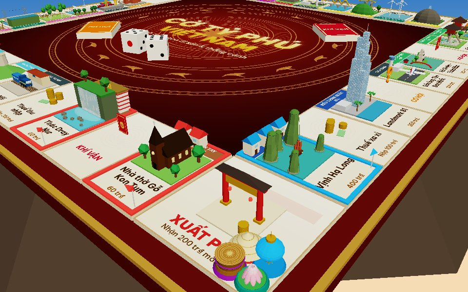
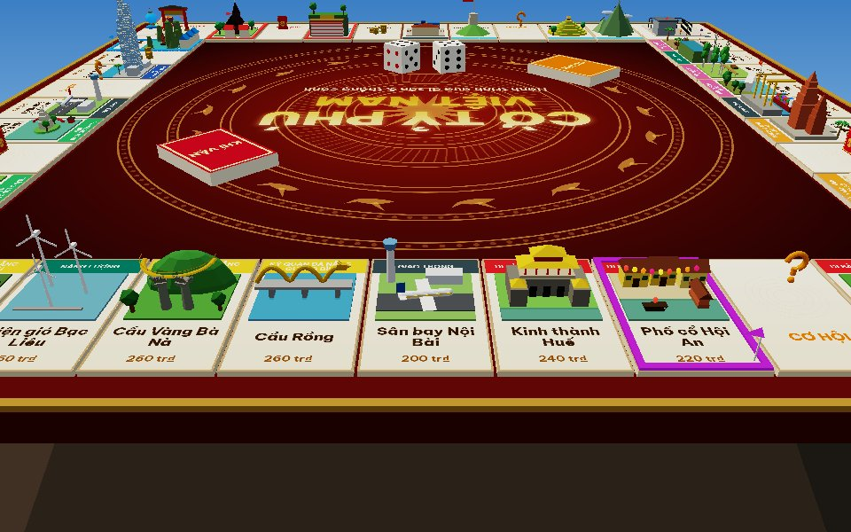

# Cờ Tỷ Phú Việt Nam 3D — bản Android (Kotlin)

Bản port sang Kotlin của game web [`vietnam-3d/`](../vietnam-3d/). Bản này chạy native trên Android: luật chơi, mô hình 3D, giao diện và lưu ván đều viết lại bằng Kotlin. Không dùng WebView, không dùng engine game bên ngoài.

| Bản web (`vietnam-3d/`) | Bản Android (`android/`) |
|---|---|
| `js/core/game.js`, `bot.js`, `js/data/*` | module `:core`, Kotlin/JVM thuần, không phụ thuộc Android |
| Three.js r170 | engine OpenGL ES 3.0 tự viết (`gl/`): cây cảnh, sinh hình kiểu Three.js, bóng đổ PCF, ACES, sương mù |
| `js/render/*` (35 mô hình procedural) | `render/`, port 1:1 từng mô hình, texture vẽ bằng `android.graphics.Canvas` |
| HTML/CSS (`hud.js`) | Jetpack Compose (`ui/`) |
| `localStorage` | `SharedPreferences` (lưu JSON trạng thái ván) |
| `<audio>` | `SoundPool` (4 hiệu ứng âm thanh lấy từ game gốc) |

Ảnh xem trước do test dựng trên JVM (renderer phần mềm, không có bóng đổ). Trên máy thật, OpenGL ES vẽ thêm bóng đổ và khử răng cưa:




## Build & cài đặt

Cần JDK 17 trở lên và Android SDK (platform 35). Trỏ SDK bằng `local.properties` (`sdk.dir=...`) hoặc biến `ANDROID_HOME`.

```bash
cd android
./gradlew assembleDebug        # app/build/outputs/apk/debug/app-debug.apk
./gradlew assembleRelease      # bản rút gọn bằng R8 (~1,5 MB), tạm ký bằng khoá debug
./gradlew installDebug         # cài lên máy đang cắm USB
```

Yêu cầu thiết bị: Android 8.0 (API 26) trở lên, có OpenGL ES 3.0.

## Kiểm thử

```bash
./gradlew :core:test               # 14 test luật chơi, gồm mô phỏng 300 ván bot (port từ tests/game.test.js)
./gradlew :app:testDebugUnitTest   # 4 test Robolectric (Canvas thật ở chế độ NATIVE)
```

Test của module `app` chạy trên JVM, không cần GPU hay máy ảo:

- **`RenderPreviewTest`** dựng toàn bộ cảnh 3D gồm 40 ô, 35 mô hình, nhà/khách sạn và quân cờ. Test kiểm tra số lệnh vẽ sau khi gộp lưới tĩnh, rồi xuất ảnh PNG các texture và 6 góc nhìn ra `app/build/preview/` bằng một renderer phần mềm nhỏ (`SoftRenderer`).
- **`ControllerFlowTest`** chạy bộ điều khiển thật với 1 người và 2 máy. Test tự "bơm" khung hình cho `Engine.update()` và tự bấm nút thay người chơi qua 4 vòng. Sau đó test kiểm tra không có lỗi, tiền hiển thị khớp trạng thái, và ván lưu xong khôi phục đúng.

## Cấu trúc

```
android/
├── core/src/main/kotlin/vn/cotyphu/core/
│   ├── BoardData.kt     # 40 ô, 8 vùng, bảng tiền thuê, định dạng tiền "1.500 tr₫"
│   ├── Cards.kt         # thẻ Cơ hội / Khí vận
│   ├── Game.kt          # engine luật chơi: hành động → danh sách GameEvent; trạng thái @Serializable
│   └── Bot.kt           # AI của máy
└── app/src/main/kotlin/vn/cotyphu/
    ├── MainActivity.kt
    ├── gl/              # Engine (GLSurfaceView.Renderer), Geometry + Geo (box, cylinder, sphere, torus,
    │                    #   lathe, capsule, extrude, tube…), Material/Texture, OrbitCamera, Batcher, Shaders
    ├── render/          # Board3D, Landmarks (35 mô hình), Tokens, Dice3D, GameWorld (biển, đảo, thuyền)
    └── ui/              # GameController (port main.js), Screens/Theme (Compose), Sound, SaveStore, GameSurface
```

Luồng một nước đi giữ nguyên như bản web. `GameController.act()` gọi engine luật chơi, nhận về danh sách sự kiện rồi diễn lần lượt từng sự kiện: xúc xắc lăn, quân nhảy từng ô, tiền bay lên, thẻ lật... Cây cảnh chỉ được sửa trên luồng OpenGL, thông qua `Engine.post`, `Engine.run` và `Engine.tween` (hàm `suspend`, chờ hoạt cảnh chạy xong).

Để vẽ mượt trên điện thoại, `Batcher` gộp các khối tĩnh dùng chung vật liệu của 40 ô thành vài trăm lưới (thay vì vài nghìn khối nhỏ). Những phần có chuyển động được đánh dấu `dyn()` nên giữ nguyên, ví dụ cờ bay, tua-bin, thuyền, đèn lồng, Cầu Rồng phun lửa.

## Điều khiển

- Kéo một ngón để xoay bàn cờ, chụm hai ngón để phóng to/thu nhỏ, kéo hai ngón để dịch chuyển.
- Chạm vào một ô để xem giới thiệu thắng cảnh và bảng giá thuê.
- 🎥 bật/tắt camera theo quân cờ · 🗺️ về toàn cảnh · 📜 nhật ký (màn hình dọc) · ❔ luật chơi · ☰ ván mới.
- Nút Back đóng hộp thoại đang mở.

## Ghi chú

- Font chữ là [Be Vietnam Pro](https://fonts.google.com/specimen/Be+Vietnam+Pro), giấy phép SIL OFL 1.1 (xem `app/src/main/assets/licenses/BeVietnamPro-OFL.txt`).
- `settings.gradle.kts` dùng mirror Maven Central của Google trước Maven Central, để tránh lỗi 429 khi tải thư viện.
- Bản release đang ký bằng khoá debug cho tiện cài thử. Khi đưa lên Google Play cần thay bằng khoá riêng trong `app/build.gradle.kts`.
