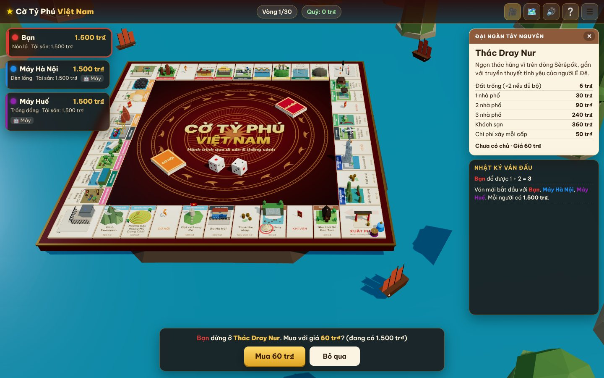
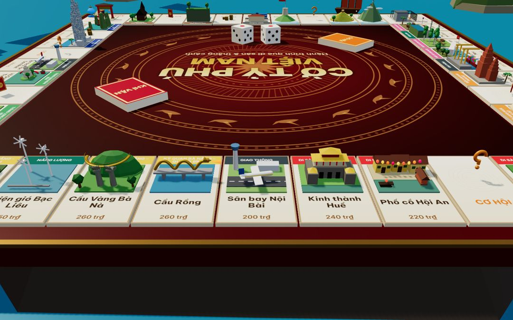

# Cờ Tỷ Phú Việt Nam 3D

Phiên bản Cờ Tỷ Phú 3D mới, viết lại từ game gốc của repo này (`monopoly/`, Django + Three.js r9x, bối cảnh khuôn viên CMU).
Bối cảnh giờ là **22 công trình, thắng cảnh Việt Nam** cùng ga, cảng, sân bay và nhà máy điện. Toàn bộ mô hình 3D được **dựng bằng code** (procedural low-poly), nên game không cần file model nào ở ngoài.




## Chạy game

Game là trang tĩnh dùng ES module, nên cần chạy qua một HTTP server (mở thẳng bằng `file://` sẽ bị trình duyệt chặn module):

```bash
cd vietnam-3d
python3 -m http.server 8080     # hoặc: npm start
# mở http://localhost:8080
```

Không cần build hay `npm install`: Three.js r170 đã được vendor sẵn trong `vendor/three/`. Có thể deploy thẳng lên GitHub Pages, Netlify hoặc bất kỳ static host nào.

Chạy test của engine luật chơi (Node ≥ 18):

```bash
npm test
```

## Có gì trong game

| Hạng mục | Nội dung |
|---|---|
| Bàn cờ | 40 ô với 8 vùng màu theo vùng miền: Tây Nguyên, Địa đầu phía Bắc, Miền Tây sông nước, Biển Nam Trung Bộ, Di sản miền Trung, Đà Nẵng – Quảng Bình, Thăng Long, Biểu tượng quốc gia |
| Thắng cảnh | Nhà thờ Gỗ Kon Tum, Thác Dray Nur, Cột cờ Lũng Cú, Ruộng bậc thang Mù Cang Chải, Fansipan, Chợ nổi Cái Răng, Rừng tràm Trà Sư, Đất Mũi Cà Mau, Tháp Bà Ponagar, Đồi cát Mũi Né, Ghềnh Đá Đĩa, Mỹ Sơn, Hội An, Kinh thành Huế, Cầu Rồng, Cầu Vàng, Sơn Đoòng, Văn Miếu, Chùa Một Cột, Hồ Gươm, Landmark 81, Vịnh Hạ Long |
| Hạ tầng | Ga Hà Nội, Cảng Cái Mép – Thị Vải, Sân bay Nội Bài, Sân bay Tân Sơn Nhất; Thuỷ điện Hoà Bình, Điện gió Bạc Liêu |
| Chuyển động | Cờ đỏ sao vàng bay phấp phới, tua-bin gió quay, Cầu Rồng phun lửa, thuyền chợ nổi dập dềnh, đèn lồng Hội An lung linh, cáp treo Fansipan, máy bay cất cánh, biển có sóng và quần đảo đá vôi bao quanh |
| Quân cờ | Nón lá, Đèn lồng, Trống đồng, Hoa sen, Thuyền thúng |
| Thẻ | Cơ hội & Khí vận mang màu sắc Việt: lì xì mùng 1 Tết, lương tháng 13, phạt nguội, trúng mùa cà phê... |
| Chế độ | 2–4 người, chơi chung một máy (hot-seat) và/hoặc đấu với máy; tự lưu ván và chơi tiếp sau |
| Giao diện | Tiếng Việt, xem được trên điện thoại; rê hoặc chạm vào ô để đọc giới thiệu thắng cảnh |

## Luật chơi

Giữ khung của game gốc (xuất phát 1.500, qua Xuất phát +200, mua đất, xây 3 nhà rồi lên khách sạn, ô Cơ hội, ô tù) và bổ sung:

- **Trọn bộ vùng**: tiền thuê đất trống ×2 và được xây tự do trong lượt của mình. Dừng ở đất của mình thì được nâng thêm 1 cấp như luật gốc.
- **Giao thông** 25/50/100/200 tr₫ theo số ô sở hữu. **Năng lượng** tính ×4 tổng xúc xắc, hoặc ×10 nếu có cả hai nhà máy.
- **Quỹ chung**: thuế và tiền phạt vào Quỹ; ai dừng ở *Bến Ninh Kiều* thì nhận hết.
- **Nhà tạm giữ**: vào khi dừng ở ô *Vào tù*, khi đổ đôi 3 lần liền hoặc do rút thẻ. Ra bằng cách đổ đôi, dùng thẻ ân xá hoặc nộp 50 tr₫ (lần thử thứ 3 thì bắt buộc nộp).
- **Thiếu tiền**: tài sản tự động được bán lại 50% giá (bán công trình trước, rồi đến đất rẻ nhất). Nếu vẫn không đủ thì phá sản.
- **Thắng**: người cuối cùng còn trụ lại, hoặc người có tổng tài sản lớn nhất khi hết số vòng giới hạn (mặc định 30 vòng).

Phím tắt: `Space` hoặc `Enter` thực hiện hành động chính, `Esc` đóng hộp thoại.

## Cấu trúc mã nguồn

```
vietnam-3d/
├── index.html            # khung giao diện + import map của three
├── css/style.css
├── js/
│   ├── main.js           # bộ điều khiển: nối engine với cảnh 3D và giao diện
│   ├── core/
│   │   ├── game.js       # engine luật chơi thuần JS (không đụng DOM), trả về danh sách sự kiện
│   │   └── bot.js        # AI của máy
│   ├── data/
│   │   ├── board-data.js # 40 ô, nhóm màu, giá, bảng tiền thuê, mô tả thắng cảnh
│   │   └── cards.js      # thẻ Cơ hội / Khí vận
│   ├── render/
│   │   ├── scene.js      # renderer, camera, ánh sáng, trời, biển, đảo
│   │   ├── board3d.js    # bàn sơn mài, texture ô vẽ bằng canvas, mặt trống đồng, nhà/khách sạn
│   │   ├── landmarks.js  # 35 mô hình procedural (thắng cảnh và các ô đặc biệt)
│   │   ├── tokens.js     # quân cờ
│   │   ├── dice3d.js     # xúc xắc 3D, dừng đúng mặt mà engine trả về
│   │   └── helpers.js
│   └── ui/{hud.js, sound.js}
├── tests/game.test.js    # 13 test, trong đó có mô phỏng 300 ván bot
├── sound/                # âm thanh dùng lại từ game gốc
└── vendor/three/         # Three.js r170 (MIT)
```

Engine chạy độc lập với phần hiển thị: mỗi hành động (`roll`, `decide`, `buildOn`, `endTurn`...) đổi trạng thái JSON rồi trả về danh sách sự kiện (`dice`, `move`, `money`, `card`, `jail`...). Phần 3D chỉ việc diễn lại các sự kiện đó theo thứ tự. Vì vậy engine test được bằng Node, và lưu/khôi phục ván chỉ là `JSON.stringify` trạng thái.

Trong console trình duyệt, `window.cotyphu` trỏ tới `stage`, `board`, `dice` và `game` để tiện gỡ lỗi.

## Ghi chú

- Mô tả thắng cảnh chỉ dùng tên địa danh quen thuộc, không ghi tên tỉnh, vì địa giới hành chính đã thay đổi sau đợt sáp nhập tỉnh năm 2025.
- Đơn vị tiền trong game là "tr₫" (triệu đồng), chỉ để vui.
